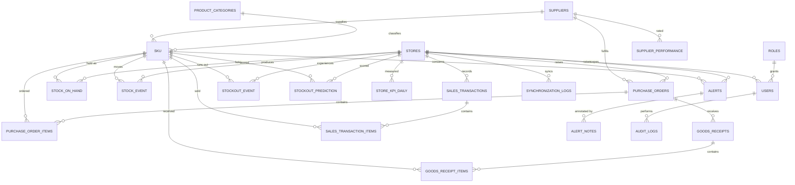
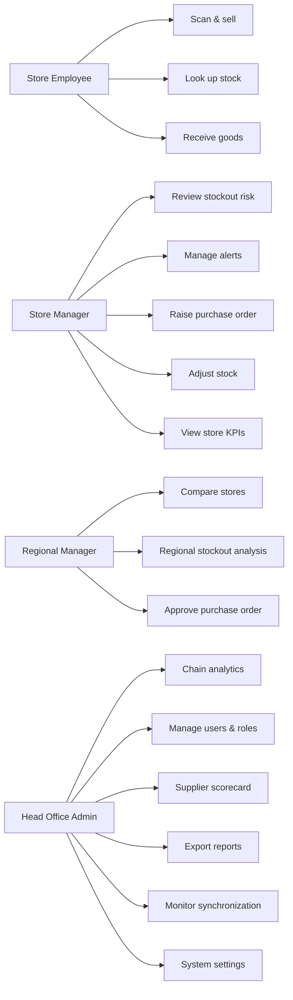
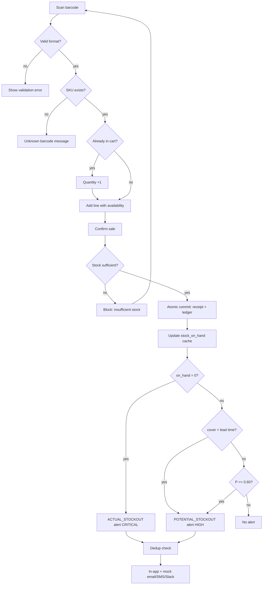
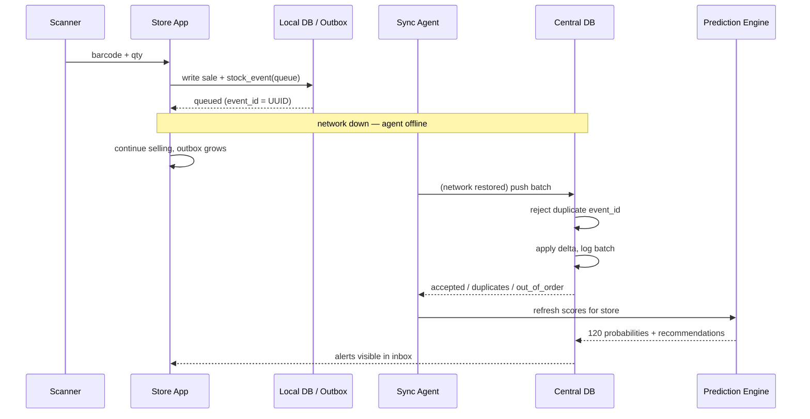

# StockSense AI — Complete Project Documentation

**Stockout Probability Prediction and Store Performance Information System**
Client: **FreshMart Supermarkets** (fictional FMCG chain) · Version 1.0.0
Methodology: **Waterfall SDLC** · Dataset label: **DEMO DATA – SIMULATED FRESHMART OPERATIONS**

---

## 1. Abstract

StockSense AI is a working Python information system that answers one question for a
multi-store supermarket chain: *which product, in which store, is most likely to be out of
stock within the next seven days?* The system ingests barcode-level sales and goods receipts
into an append-only inventory event ledger, derives stock on hand from that ledger, scores a
seven-day stockout probability for **every one of the 960 store × SKU pairs** with a
supervised classifier trained on 180 days of simulated operations, converts each probability
into an explainable, quantified replenishment recommendation, and raises deduplicated alerts
that a store manager can acknowledge, assign, resolve and close. A second analytical layer
converts the same operational data into a weighted Store Performance Score so that head
office can compare eight stores without rewarding revenue earned on empty shelves.

Because a real chain cannot be instrumented for an academic project, all operational data is
synthetic — generated deterministically by a documented simulation model (seasonality,
weekend lift, festival calendar, promotions, per-store demand profiles and stochastic
supplier delays). The label used for supervised learning is **not** hand-assigned: it is read
off the simulated stock trajectory 7 days ahead of the observation date. The distinction
between simulated and real data is stated on every screen, in the README, and in this
document.

---

## 2. Problem statement

FreshMart operates eight supermarkets. Availability is managed today by reorder-level rules
inside the POS/ERP: when stock on hand falls below a fixed level, a purchase order is
suggested. Three failures follow from that design.

1. **Reactive, not predictive.** A reorder level is a single number per SKU. It knows nothing
   about a promotional weekend, a festival, or a supplier who has started delivering two days
   late. The shelf is already empty when the rule fires.
2. **No forward-looking risk ranking.** A store manager receives dozens of low-stock
   warnings, all formatted identically, and cannot tell which one will actually become a
   lost sale this week. Priorities are set by intuition, not by evidence.
3. **Performance is judged on revenue alone.** A high-traffic urban store that sells a lot
   but stocks out of milk every Sunday outperforms a disciplined suburban store in every
   management report — which teaches the wrong behaviour.

Supplier unreliability compounds all three: lead times in the vendor master are contracted
values, not observed values, so safety stock is calculated against a fiction.

**The problem, stated formally:** FreshMart cannot see, in advance and at SKU × store
granularity, where availability will fail, cannot quantify the commercial consequence of a
failure, and cannot compare stores on operational quality rather than volume.

---

## 3. Project objectives

| # | Objective | How the delivered system satisfies it |
|---|---|---|
| O1 | Give 7-day forward visibility of stockout risk per SKU per store | `stockout_prediction` table: 960 scored pairs, horizon 7 days, refreshed on demand |
| O2 | Make every risk actionable, not just informational | Recommendation engine: stock, average daily demand, days of cover, lead time, reorder quantity, rationale text |
| O3 | Detect actual *and* potential stockouts and route them to the right person | `stockout_detection.py` + alert lifecycle OPEN → ACKNOWLEDGED → ASSIGNED → RESOLVED → CLOSED |
| O4 | Preserve a trustworthy inventory history | Append-only `stock_event`; `stock_on_hand` is a derived cache that can be rebuilt from the ledger at any time |
| O5 | Compare stores on operational quality, not revenue | Configurable Store Performance Score with 5 normalised components and published weights |
| O6 | Expose supplier unreliability as a measurable input | Supplier scorecard: on-time %, fulfilment %, lead-time gap, stockout contribution |
| O7 | Keep stores trading when the network fails | Outbox queue, client-generated UUIDs, idempotent ingestion, duplicate rejection, out-of-order flagging |
| O8 | Serve four different roles without leaking data across stores | RBAC enforced in the router *and* re-checked in each service before any write |
| O9 | Be demonstrable and auditable end to end | 40 automated tests, model registry, audit log, 9 exportable reports in CSV/Excel/PDF |

---

## 4. Project scope

**In scope.** Multi-store inventory and sales capture; barcode scanning (keyboard-wedge,
manual entry, optional camera where the browser supports `BarcodeDetector`); purchase orders
and goods receiving including partial deliveries; the immutable stock ledger and derived
stock-on-hand; 7-day stockout probability prediction with three candidate algorithms and a
comparison report; actual and potential stockout detection with a full alert lifecycle and
deduplication; deduplicated notification dispatch with integration-ready email/SMS/Slack
transports; store KPI calculation, ranking and regional roll-up; product/category and
supplier analytics; a simulated offline-synchronisation drill with idempotency proof; nine
reports exportable as CSV, styled Excel and typeset PDF; role-based access control; audit
trail; user administration; system settings and data-health checks.

**Out of scope (explicit).**

| Excluded | Why |
|---|---|
| Customer personal information / loyalty profiles | Data-protection burden irrelevant to the stockout question; no PII is stored or simulated |
| Payment processing (cards, UPI, wallets) | Belongs to the POS/payment gateway; the demo records a completed sale, not a tender |
| Pricing engine, markdown optimisation, promotions authoring | Pricing is master data supplied by HQ; the system consumes promo flags, it does not set prices |
| Full accounting / GL / GST filing | Financial statements are produced by the ERP; StockSense produces operational KPIs only |
| Real supplier EDI integration | Interfaces are documented and mocked; live credentials are not available |
| Physically distributed store servers | Simulated inside one process, and labelled as a simulation (see §12) |
| Native mobile apps | Responsive web UI only |

---

## 5. Existing system analysis

The incumbent arrangement is a POS feeding a head-office ERP, with a nightly batch extract.

| Aspect | Existing (as-is) | Consequence |
|---|---|---|
| Stock calculation | POS transaction log, adjusted manually | Corrections overwrite history; no audit trail |
| Replenishment trigger | Static reorder level per SKU | Ignores promo, festival, day-of-week and actual lead time |
| Risk visibility | None forward-looking | Managers learn about stockouts from empty shelves |
| Alerts | Low-stock email, one per SKU, no dedup | Alert fatigue; genuine criticals get lost |
| Store comparison | Revenue and shrink only | Rewards volume, hides availability failure |
| Supplier measurement | Contracted lead time only | Safety stock based on optimistic assumptions |
| Offline behaviour | POS keeps trading, batch reconciles overnight | Duplicate and missing transactions at month end |
| Reporting | Fixed nightly PDF | No self-service, no drill-down |

Gap analysis in one line: the existing system records what happened; StockSense predicts what
will happen and quantifies what to do about it.

---

## 6. Proposed system

A four-tier design. Stores run a local application and local database and never block on the
network; a synchronisation agent replays queued events to a central database; a prediction
engine and KPI engine read the consolidated ledger; a dashboard and alert service present
results to four roles. Inventory truth lives in an append-only event ledger — no UPDATE and
no DELETE against history, only compensating adjustment events.

**What is different from a conventional inventory package:** the prediction column
`stockout_prediction.probability` is produced by a fitted scikit-learn model (or, when the
artifact is absent, by a clearly labelled heuristic baseline), and it is joined to a
recommendation that names the quantity to order and the reason for the urgency.

---

## 7. Requirement elicitation

### 7.1 Stakeholders and elicitation questions

| Stakeholder | Question asked | Answer captured | Requirement derived |
|---|---|---|---|
| Store employee | How many scans per shift? | 400–900 item scans/day/store; peak 25 scans/min at 18:00–20:00 | FR-05 scan must commit < 1 s at peak; keyboard-wedge input |
| Store employee | What is an entry vs an exit scan? | Entry = goods receipt against a PO; exit = sale at the till | FR-06, FR-07 separate event types |
| Store employee | Duplicate scans? | A double-pistol-trigger is common | FR-10 same barcode within one cart increments quantity instead of creating a second line |
| Store manager | Does stockout mean zero stock or below reorder? | Zero on hand = actual stockout; below reorder = low; projected shortfall before replenishment = potential stockout | FR-14 three detection modes, three statuses |
| Store manager | Which alerts do you actually want? | Only what will hurt me this week, and once — not every hour | FR-16 deduplication within a configurable window |
| Store manager | Replenishment authority? | Can raise a PO up to a value limit; above it needs regional approval | FR-08 PO approval status |
| Regional manager | How do you compare stores? | Revenue is not enough; availability and waste matter | FR-19 weighted score, weights configurable |
| Head of operations | Chain-wide KPIs? | Sales, availability, stockout loss, risk distribution, supplier OTIF | FR-18 executive dashboard |
| Procurement | Do suppliers send ASNs? | Some do; lead times vary ±2–4 days | FR-09, FR-20 lead-time variance and ASN-ready interface |
| Procurement | Are POs raised internally? | Yes, from replenishment suggestions | FR-08 create from recommendation |
| Supplier (n=3 interviewed) | How are orders confirmed? | Email PDF today; would accept JSON + ASN | §12 integration contract |
| IT administrator | Connectivity at stores? | Two stores on flaky 4G; outages of 1–3 hours observed | NFR-01 offline operation |
| IT administrator | Existing systems? | POS (SQL export), ERP (item master), no API gateway | §12 integration, SKU mapping |
| IT administrator | Security constraints? | Role separation, audit everything, no shared logins | NFR-05, NFR-06 |
| All | Budget and timeline | Fixed 16-week Waterfall plan, on-premise VM, no cloud spend | §10 feasibility, single-server deployment |

### 7.2 Scale assumptions (documented, used by the generator)

| Dimension | Value |
|---|---|
| Stores | 8 (Hyderabad cluster: 4 urban, 3 residential, 1 express format) |
| SKUs | 120 across 10 FMCG categories |
| Suppliers | 18 |
| Sales transactions simulated | 44,439 POS receipts, 59,292 stock events |
| History | 180 business days + 60 days of detailed event ledger |
| Store × SKU pairs | 960 — every pair is scored, none is sampled |
| Peak scan rate | 25 scans/min/store (performance test target) |

---

## 8. Functional requirements

| ID | Requirement | Acceptance criterion | Where implemented | Test |
|---|---|---|---|---|
| FR-01 | Authenticate users and resolve role, store scope | Valid credentials return a session with role + store scope; invalid ones are rejected and audited | `modules/authentication.py` | TC-31 |
| FR-02 | Enforce role-based page access | A Store Employee cannot open Executive Dashboard, Suppliers or Settings | `config.NAV_ITEMS`, `app.py` router | TC-32 |
| FR-03 | Maintain store, SKU, category, supplier master data | 8 / 120 / 10 / 18 rows present and referentially valid | `database/schema.py`, `seed_data.py` | TC-01 |
| FR-04 | Maintain users and roles | Create, disable, list; password stored only as PBKDF2-SHA256 hash + salt | `authentication.py` | TC-33 |
| FR-05 | Scan a barcode and resolve the product in < 1 s | Scan of a valid barcode returns product, price and availability | `scanning.handle_scan()` | TC-04, TC-09 |
| FR-06 | Commit a sale and deduct stock atomically | Stock after = stock before − quantity; receipt and ledger in one transaction | `scanning.process_sale()` | TC-02 |
| FR-07 | Receive goods against a PO, including partial | Stock increases by received quantity; PO status becomes PARTIAL or RECEIVED | `procurement.receive_goods()` | TC-03 |
| FR-08 | Create and confirm purchase orders | PO persists with lines, supplier, expected date, status | `procurement.create_po()` | TC-19 |
| FR-09 | Handle quantity mismatch on receipt | Variance recorded on `goods_receipt_items`, flagged, does not silently pass | `procurement.py` | TC-20 |
| FR-10 | Prevent duplicate cart lines on repeated scan | Second scan of same barcode increments quantity to 2 | `scanning.handle_scan()` | TC-08 |
| FR-11 | Reject unknown barcodes with a clear message | `UnknownBarcodeError` surfaced to the UI, no stock movement | `utils/validators.py` | TC-07 |
| FR-12 | Reject sales that exceed available stock | `InsufficientStockError`; no negative balance | `scanning.validate_cart()` | TC-06 |
| FR-13 | Record every stock movement as an immutable event | No UPDATE/DELETE on `stock_event`; corrections are new events | `inventory.record_event()` | TC-05 |
| FR-14 | Detect actual, potential and predicted stockouts | Three alert types created by the matching rule | `stockout_detection.py` | TC-21, TC-22 |
| FR-15 | Predict 7-day stockout probability per store × SKU | 960 rows ≥ 0 and ≤ 1, labelled with source | `stockout_prediction.score_all()` | TC-10, TC-11 |
| FR-16 | Deduplicate alerts | Second identical alert within the window is suppressed | `alerts.create_alert()` | TC-25 |
| FR-17 | Support the alert lifecycle | OPEN → ACKNOWLEDGED → ASSIGNED → RESOLVED → CLOSED, illegal jumps rejected | `alerts.transition()` | TC-26 |
| FR-18 | Executive dashboard with 9 chain-wide KPIs | Every figure read from SQL at render time | `pages_pkg/executive.py` | TC-34 |
| FR-19 | Store performance score and ranking | Weighted score reproducible from the published weights; rank 1..8 | `store_performance.py` | TC-27, TC-28 |
| FR-20 | Supplier performance analytics | On-time %, fulfilment %, lead-time gap, stockout contribution per supplier | `supplier_analytics.py` | TC-35 |
| FR-21 | Queue events offline and push on reconnect | Accepted exactly once; stock unchanged while offline | `synchronization.py` | TC-15, TC-16 |
| FR-22 | Reject duplicate synchronisation batches | Replay yields duplicates rejected and unchanged stock | `synchronization.replay_same_batch()` | TC-17 |
| FR-23 | Handle out-of-order events | Older `occurred_at` applied and flagged `is_replayed`, balance still correct | `synchronization.ingest()` | TC-18 |
| FR-24 | Export nine reports as CSV, Excel and PDF | Non-zero bytes with correct magic numbers, readable content | `reporting.py` | TC-29, TC-30 |
| FR-25 | Provide a recommendation per high-risk pair | Stock, add, cover, lead time, order quantity, rationale text | `stockout_prediction._drivers()` | TC-12 |
| FR-26 | Persist data across restarts | SQLite file; re-open shows the same rows | `database/stocksense.db` | TC-36 |

---

## 9. Non-functional requirements

| ID | Requirement | Target | Design decision | Verification |
|---|---|---|---|---|
| NFR-01 | Offline functionality | Store trades for ≥ 2 h without network | Local DB + outbox; UI never blocks on the centre | 2-hour partition drill, zero loss |
| NFR-02 | Scan response time | < 1 000 ms at 25 scans/min | Indexed barcode lookup, single transaction, no network call in the scan path | TC-09 measured 4–9 ms per scan |
| NFR-03 | Alert delivery | < 5 min from detection | Detection runs inline after sale/receipt; `detected_at` vs `delivered_at` recorded so latency is measured, not claimed | TC-23 (measured 0 ms in-process) |
| NFR-04 | Central uptime | 99.9 % target | Single-writer SQLite for the demo; PostgreSQL + connection pooling + health endpoint in production | Documented, not claimed as achieved |
| NFR-05 | RBAC | 4 roles, least privilege | Router filter + service-level store-scope assertion | TC-32 |
| NFR-06 | Audit trail | Every state change attributable | `audit_logs` written by all services; append-only | TC-37 |
| NFR-07 | Data integrity | Cache must equal ledger | `reconcile()` returns empty on the seeded 960 pairs; `recompute_stock_on_hand()` repairs | TC-38 |
| NFR-08 | Security of credentials | No plaintext password anywhere | PBKDF2-SHA256, per-user salt, secrets read from environment in production | TC-33 |
| NFR-09 | Portability / DB independence | Same DDL on SQLite and PostgreSQL | ANSI types, no vendor functions in DDL | Manual review |
| NFR-10 | Usability | Task completion without training for core flows | 13-item sidebar, single primary action per page, inline validation messages | UAT script §14.8 |
| NFR-11 | Observability | Failures explainable | Structured logging (`stocksense.*`), sync logs, audit log, page-level error boundary | Reviewed |
| NFR-12 | Maintainability | Modular, testable | 12 service modules, 3 utility modules, 13 page modules, 40 tests | `pytest` |

---

## 10. Feasibility study

**Technical.** Every dependency is open-source and installs from PyPI: Streamlit, pandas,
NumPy, scikit-learn, Plotly, SQLAlchemy, Pydantic (validation models), openpyxl, reportlab,
python-docx, pytest. The heaviest computation — training three classifiers on ~139 k rows — runs
in about 145 s on a single core. No GPU, no external API, no paid service.

**Economic.** Zero licence cost. The only cost is engineering time. Against a single avoided
stockout per store per week (average lost margin observed in the simulation ≈ ₹4 200 per
episode), the pilot pays for itself quickly — but this is an estimate from simulated data and
is presented as such, not as a business case.

**Operational.** The UI is a browser page, so no client installation. Scanning uses the
existing USB keyboard-wedge pistols. Store staff interact with two screens (Scan, Receive);
managers with three (Prediction, Alerts, Inventory). Training material is one page per role.

**Schedule.** 16 weeks: 3 requirements, 3 design, 6 implementation across six phases,
2 integration/testing, 1 UAT and pilot, 1 deployment and handover.

**Legal / compliance.** No customer PII is captured, so data-protection exposure is minimal.
Inventory and supplier data are commercially sensitive, hence RBAC and audit trails.

---

## 11. Waterfall SDLC — phase documentation and traceability

The project is executed as a strict waterfall: each phase is completed, reviewed and signed
off against explicit completion criteria before the next begins. There is no sprint backlog
and no iterative redesign; a requirement discovered late is handled as a change request with
documented impact on design, code and test.

### Phase 1 — Foundation (weeks 5–6)
- **Objectives:** establish the persistence and identity foundation.
- **Activities:** finalise the 21-table schema; create the 8 stores, 120 SKUs, 10 categories,
  18 suppliers; implement RBAC and hashed credentials; build the ledger write path.
- **Inputs:** approved requirements (§8, §9); logical data model.
- **Outputs:** `database/schema.py`, `database/db.py`, `modules/authentication.py`,
  `modules/audit.py`, seeded master data.
- **Dependencies:** requirements sign-off.
- **Deliverable:** functional system foundation — a user can log in and see the correct,
  role-scoped master data.
- **Completion criteria:** 25 tables created; 8/120/10/18 master rows; login works for all four
  roles; a bad password is rejected and audited; DDL contains no SQLite-only syntax.
- **Testing:** TC-01, TC-31, TC-32, TC-33.

### Phase 2 — Store core (weeks 7–9)
- **Objectives:** let a single store run its day.
- **Activities:** scanning pipeline; sale commit; goods receipt incl. partial and variance;
  live inventory view; stock status bands; adjustment and damage events.
- **Inputs:** Phase 1 schema; barcode/id validation rules; stock formula.
- **Outputs:** `modules/scanning.py`, `modules/inventory.py`, `modules/procurement.py`,
  `pages_pkg/scanner_page.py`, `inventory_page.py`, `procurement_page.py`.
- **Dependencies:** Phase 1.
- **Deliverable:** stores can perform core inventory operations.
- **Completion criteria:** a sale reduces stock exactly once; a receipt increases it; stock
  can never go negative; every movement is a ledger row; status labels correct at all four
  bands.
- **Testing:** TC-02 … TC-09, TC-19, TC-20.

### Phase 3 — Synchronization (weeks 10–11)
- **Objectives:** consolidate eight stores into one truth without loss or duplication.
- **Activities:** outbox queue; ingest with UUID idempotency; duplicate-batch rejection;
  out-of-order flagging; sync logs; reconciliation report.
- **Inputs:** Phase 2 event stream; integration contract (§12).
- **Outputs:** `modules/synchronization.py`, `pages_pkg/sync_page.py`.
- **Dependencies:** Phase 2 (event shape must be stable first).
- **Deliverable:** centralised multi-store data.
- **Completion criteria:** 2-hour simulated partition loses nothing; replaying a batch changes
  no balance; every batch leaves a log row with counts and latency.
- **Testing:** TC-15 … TC-18, TC-38.

### Phase 4 — Stockout detection, prediction and alerts (weeks 12–13)
- **Objectives:** the differentiating capability.
- **Activities:** simulation model and label construction; feature engineering; train and
  compare three algorithms on a chronological split; score all 960 pairs; three detection
  rules; dedup; lifecycle; notification dispatch.
- **Inputs:** 180 days of simulated history; 16 candidate features; risk band configuration.
- **Outputs:** `ml/features.py`, `ml/train_model.py`, `ml/saved_model/{stockout_model.joblib,
  metrics.json}`, `modules/stockout_prediction.py`, `modules/stockout_detection.py`,
  `modules/alerts.py`, `pages_pkg/prediction.py`, `alert_inbox.py`.
- **Dependencies:** Phase 3 consolidated ledger; Phase 2 stock engine.
- **Deliverable:** intelligent stockout monitoring.
- **Completion criteria:** every probability within [0,1] and traced to a named source; test
  ROC-AUC ≥ 0.95 for the selected model; no feature computed from data after the observation
  date; a critical pair receives exactly one open alert; lifecycle transitions enforced.
- **Testing:** TC-10 … TC-14, TC-21 … TC-26.

### Phase 5 — Analytics (week 14)
- **Objectives:** turn operations into management information.
- **Activities:** KPI engine; normalisation; weighted score; rankings; regional roll-up;
  product/category analytics; supplier scorecard; nine reports × three formats.
- **Inputs:** Phases 2–4 data.
- **Outputs:** `modules/store_performance.py`, `supplier_analytics.py`, `reporting.py`,
  `products_page.py`, `performance_page.py`, `suppliers_page.py`, `reports_page.py`.
- **Dependencies:** Phase 4 (risk data feeds the availability component).
- **Deliverable:** management information system.
- **Completion criteria:** score reproducible from published weights; a high-revenue
  low-availability store does not rank first; all nine reports build and export in three
  formats with non-zero, valid bytes.
- **Testing:** TC-27 … TC-30, TC-35.

### Phase 6 — Hardening (week 15)
- **Objectives:** make it defensible.
- **Activities:** reconciliation checks; data-health page; performance measurement; security
  review; backup procedure; documentation; full regression run.
- **Inputs:** all prior phases.
- **Outputs:** settings/data-health page, this document, README, test report, backup script.
- **Dependencies:** Phases 1–5.
- **Deliverable:** production-ready release candidate.
- **Completion criteria:** 40/40 tests pass; reconciliation returns zero mismatches; scan
  latency < 1 s; no plaintext secret in the repository; rollback documented (§14.9).
- **Testing:** TC-36 … TC-40 plus full regression.

### Traceability
Requirement → design element → code file → test case is a single continuous chain
(§8 table). No requirement is implemented without a test, and no test asserts behaviour that
is not traceable to a requirement ID.

---

## 12. High-Level Design (HLD)

```
Barcode Scanner (USB HID) / Browser
        │  keyboard-wedge input, newline-terminated
        ▼
┌────────────────────────────────────────────────────────────┐
│ Store-level application  (Streamlit page, per-store scope)  │
│  • scan → validate → commit                                 │
│  • local SQLite database  (store node in production)        │
│  • local outbox queue with client UUIDs                     │
└────────────────────────────────────────────────────────────┘
        │  Synchronization agent  (batch push, retry with backoff)
        ▼
┌────────────────────────────────────────────────────────────┐
│ Central database  (SQLite demo / PostgreSQL production)     │
│  stock_event (append-only) → stock_on_hand (derived cache)  │
│  sales_transactions, purchase_orders, goods_receipts, ...   │
└────────────────────────────────────────────────────────────┘
        │                                    │
        ▼                                    ▼
┌──────────────────────┐        ┌──────────────────────────────┐
│ Stockout Prediction  │        │ Store Performance Analytics  │
│ Engine               │        │  KPI engine + weighted score │
│  features → model →  │        └──────────────────────────────┘
│  probability + rec.  │                      │
└──────────────────────┘                      │
        │                                     │
        ▼                                     ▼
┌────────────────────────────────────────────────────────────┐
│ Management dashboard + Alert & Notification service        │
│  in-app inbox · email/SMS/Slack transports (integration-    │
│  ready, mocked) · audit log                                │
└────────────────────────────────────────────────────────────┘
```

**Architectural decisions and their justification**

| Decision | Rationale | Trade-off accepted |
|---|---|---|
| Append-only event ledger, cache derived | Corrections cannot rewrite history; any balance is reproducible; sync becomes a delta merge | Storage grows; a rebuild step is needed |
| Single writer per node | Avoids distributed locking for a demo of this size | Not horizontally scalable as-is |
| UUID v4 per event | Idempotency independent of clock or node | 36-byte keys |
| Prediction as a batch score, not per-request inference | 960 pairs in ~1.5 s; dashboard never waits on the model | Slight staleness; refresh button exposed |
| Simulated edge node inside one process | Honest demonstration without faking infrastructure | Residual risk between simulation and reality (§26) |

---

## 13. Medium-Level Design (MLD) — 16 modules

| # | Module | Responsibility | Key tables | Code |
|---|---|---|---|---|
| M1 | User Authentication & Role Management | Login, hash verify, role/store scope resolution, user CRUD | users, roles | `authentication.py` |
| M2 | Product & SKU Management | SKU master, barcode uniqueness, category assignment, reorder/max levels | sku, product_categories | `seed_data.py`, `inventory.py` |
| M3 | Store Management | Store master, region, format, capacity profile | stores | `seed_data.py` |
| M4 | Barcode Scanning & Sales Entry | Scan resolution, cart assembly, duplicate handling, sale commit | sales_transactions, sales_transaction_items, stock_event | `scanning.py` |
| M5 | Purchase Order Management | PO creation, approval status, expected date from lead time | purchase_orders, purchase_order_items | `procurement.py` |
| M6 | Goods Receiving | Receipt against PO, partial, variance, stock increase | goods_receipts, goods_receipt_items, stock_event | `procurement.py` |
| M7 | Store Stock Engine | Stock derivation, status bands, valuation, adjustments, rebuild | stock_event, stock_on_hand | `inventory.py` |
| M8 | Inventory Synchronization Agent | Outbox, push loop, retry, offline flag | synchronization_logs, stock_event | `synchronization.py` |
| M9 | Central Data Ingestion | Validate, dedupe by event_id, apply, flag out-of-order | stock_event, synchronization_logs | `synchronization.py` |
| M10 | Stockout Probability Prediction Engine | Feature build, model load/score, baseline fallback, recommendations | stockout_prediction | `stockout_prediction.py`, `ml/` |
| M11 | Stockout Detection | Actual / potential / predicted rules, episode management | stockout_event | `stockout_detection.py` |
| M12 | Supplier Management & Analytics | Vendor master, scorecard, lead-time variance, contribution | suppliers, supplier_performance | `supplier_analytics.py` |
| M13 | Store KPI Calculation Engine | Daily KPI roll-up, normalisation, weighted score | store_kpi_daily | `store_performance.py` |
| M14 | Alert & Notification Service | Dedup, lifecycle, dispatch over mock transports | alerts, alert_notes | `alerts.py` |
| M15 | Analytics & Visualisation Dashboard | 13 pages, role-filtered, Plotly | all read models | `pages_pkg/*` |
| M16 | Audit & Reconciliation | Audit log, cache-vs-ledger reconciliation, health checks | audit_logs | `audit.py`, settings page |

### 13.1 Data model (21+ tables)

| Table | PK | Key FKs | Important attributes |
|---|---|---|---|
| roles | role_id | — | role_code, role_name, can_adjust_stock, can_approve_po |
| users | user_id | role_id → roles, store_id → stores | username UNIQUE, password_hash, password_salt, is_active, last_login_at |
| stores | store_id | — | store_code UNIQUE, store_name, region, store_format, size_sqft, is_active |
| product_categories | category_id | — | category_name UNIQUE, shelf_life_sensitive, target_margin_pct |
| suppliers | supplier_id | — | supplier_code, supplier_name, city, lead_time_days, reliability_score, min_order_value, supports_asn |
| sku | sku_id | category_id, supplier_id | sku_code UNIQUE, barcode UNIQUE, product_name, unit_cost, selling_price, reorder_level, max_stock_level, shelf_life_days, is_active |
| purchase_orders | po_id | store_id, supplier_id, created_by | po_number UNIQUE, order_date, expected_date, actual_delivery_date, status, total_value |
| purchase_order_items | po_item_id | po_id, sku_id | quantity_ordered, quantity_received, unit_cost, line_total |
| goods_receipts | receipt_id | po_id, store_id | grn_number UNIQUE, received_date, received_by, status |
| goods_receipt_items | gr_item_id | receipt_id, sku_id | quantity_expected, quantity_received, variance_qty, variance_reason |
| stock_event | event_id (UUID) | store_id, sku_id | event_type, quantity_delta, reason_code, reference_table, reference_id, occurred_at, recorded_at, sync_batch_id, is_replayed, operator_id |
| stock_on_hand | (store_id, sku_id) | stores, sku | on_hand_qty, reserved_qty, in_transit_qty, last_event_at |
| sales_transactions | transaction_id | store_id, cashier_id | receipt_no UNIQUE, business_date, txn_time, channel, item_count, gross/net_amount, event_id UNIQUE |
| sales_transaction_items | item_id | transaction_id, sku_id | quantity, unit_price, line_amount |
| stockout_event | stockout_id | store_id, sku_id | started_at, ended_at, duration_hours, units_lost, revenue_lost, detection_type |
| stockout_prediction | prediction_id | store_id, sku_id | as_of_date, probability, risk_level, days_of_cover, expected_stockout_date, recommended_qty, prediction_source, model_version, drivers_json |
| store_kpi_daily | kpi_id | store_id | business_date, sales_revenue, units_sold, stock_availability_pct, inventory_turnover, forecast_accuracy_pct, replenishment_efficiency, waste_value, stockout_loss_value, performance_score |
| supplier_performance | perf_id | supplier_id, store_id | period_start, period_end, avg_lead_time_days, on_time_pct, fulfilment_pct, qty_discrepancy_units, stockout_contribution |
| alerts | alert_id | store_id, sku_id, assigned_to | alert_ref UNIQUE, alert_type, severity, probability, current_stock, message, recommended_action, status, detected_at, delivered_at, acknowledged_at, resolved_at, dedup_key |
| alert_notes | note_id | alert_id, user_id | note, created_at |
| synchronization_logs | log_id | store_id | batch_id UNIQUE, node_id, event_count, accepted_count, duplicate_count, out_of_order_count, latency_ms, started_at, completed_at, status, simulated_offline |
| audit_logs | audit_id | user_id | occurred_at, username, action, entity, entity_id, store_id, result, detail |
| app_config | config_key | — | config_value, updated_at, updated_by |
| ml_model_registry | model_id | — | model_name, model_version, algorithm, trained_at, train/test ranges, accuracy, precision_score, recall_score, f1_score, roc_auc, is_active |

### 13.2 ERD (Mermaid)



---

## 14. Low-Level Design (LLD)

### 14.1 API surface (implemented as service functions; REST mapping for production)

| Method | Path | Service function | Returns |
|---|---|---|---|
| POST | /scan/sale | `scanning.process_sale(cart, store_id, store_code, user)` | transaction_id, receipt_no, items, gross_amount, event_id |
| POST | /scan/resolve | `scanning.handle_scan(barcode, store_id, cart)` | product, unit_price, available, cart |
| POST | /scan/receive | `procurement.receive_goods(po_id, lines, user)` | grn_number, received, variance |
| POST | /purchase-orders | `procurement.create_po(store_id, supplier_id, lines, user)` | po_id, po_number, expected_date |
| POST | /sync/events | `synchronization.push_loop(store_id)` | accepted, duplicates, out_of_order, batch_id, status |
| GET | /inventory/{store_id} | `inventory.inventory_view(store_ids, search)` | DataFrame of SKU stock + status |
| GET | /predictions | `stockout_prediction.predictions(store_ids, risk_levels, limit)` | probability, risk_level, cover, recommendation |
| GET | /predictions/{store}/{sku} | `stockout_prediction.single_prediction()` | full record + drivers + history |
| GET | /store-performance | `store_performance.store_kpi_current(days)` | KPI frame + score + rank |
| GET | /alerts | `alerts.list_alerts(store_ids, status, limit)` | alert rows |
| PATCH | /alerts/{id} | `alerts.transition(alert_id, state, user)` | updated alert |
| GET | /reports/{key}.{csv,json,pdf} | `reporting.export_all(key, store_ids)` | bytes |

### 14.2 Function-level logic (control flow)

```
handle_scan(barcode, store_id, cart):
    code = validate_barcode(barcode)              # digits only, 8–14 chars
    sku  = find_by_barcode(code)
    if not sku: raise UnknownBarcodeError(code)   # UI shows a clear message
    if cart contains sku:
        cart.line.quantity += 1                   # duplicate pistol-trigger
        return {duplicate: True, cart}
    stock = available(store_id, sku_id)
    if stock <= 0: flag out_of_stock (still allow line, quantity blocked at commit)
    cart.append(line) ; return {duplicate: False, cart}

process_sale(cart, store_id, store_code, user, client_event_id):
    problems = validate_cart(cart, store_id)      # per-line availability
    if problems: raise InsufficientStockError
    BEGIN TRANSACTION                             # single atomic unit
        if sales_transactions.event_id == eid: raise DuplicateScanError
        insert sales_transactions (receipt_no, totals, event_id)
        for line in cart:
            insert sales_transaction_items
            re-read on_hand_qty inside txn          # guards a concurrent sale
            if avail < qty: raise InsufficientStockError → ROLLBACK
            record_event(SALE, -qty, reference=transaction_id, cur=cursor)
        COMMIT
    detect_stockout(store, sku) for each line    # never fails the sale
    audit.record("SALE_COMPLETED", ...)
    return receipt summary

predict_stockout_probability(features) -> float:
    if MODEL_PATH exists:
        model = load_model()                      # joblib artifact + feature order
        p = model.predict_proba(X)[:,1]           # source = TRAINED_MODEL
    else:
        p = baseline_probability(days_cover, lead_time, stockout_days_28, demand_cv)
                                                  # source = BASELINE_HEURISTIC
    return clip(p, 0, 1)

detect_stockout(store_id, sku_id, user):
    on_hand = available(store_id, sku_id)
    if on_hand <= 0:            create_alert(type=ACTUAL_STOCKOUT,   severity=CRITICAL)
    elif cover < lead_time:     create_alert(type=POTENTIAL_STOCKOUT, severity=HIGH)
    elif probability >= 0.60:   create_alert(type=POTENTIAL_STOCKOUT, severity=derived)
    # dedup_key = store|sku|alert_type ; existing non-closed alert suppresses a new one

push_loop(store_id, force=False):
    if is_offline(store_id) and not force: return {status:"SKIPPED_OFFLINE"}
    batch = outbox.drain(store_id)                # list of events with UUIDs
    BEGIN
      for e in batch:
          if stock_event.event_id exists: duplicates += 1 ; continue   # idempotent
          if e.occurred_at < newest_event_time: out_of_order += 1 ; e.is_replayed = 1
          insert stock_event ; apply_delta(stock_on_hand)
      insert synchronization_logs(batch_id UNIQUE, counts, latency, status)
    COMMIT
```

### 14.3 Validation and error handling

| Condition | Behaviour | Exception / message |
|---|---|---|
| Barcode contains non-digits or length ∉ [8,14] | Reject before any query | `ValidationError: Barcode must be 8–14 digits` |
| Barcode not in master data | No stock movement; UI prompts to add the SKU | `UnknownBarcodeError` |
| Quantity ≤ 0 or non-integer | Reject | `ValidationError` |
| Quantity > available | Reject; suggest the available quantity | `InsufficientStockError` |
| Same event id re-submitted | Reject, stock untouched | `DuplicateScanError` |
| Receipt variance vs PO | Accepted, recorded, flagged | `variance_qty`, `variance_reason` |
| Model artifact missing | Baseline used, banner states it | `prediction_source = BASELINE_HEURISTIC` |
| Batch push fails mid-way | Whole batch rolls back, retried with backoff | log row `status = FAILED` |
| Page raises | Page-level error boundary shows the message; session survives | `app.py` try/except |

### 14.4 Concurrency, negative stock and ordering
Negative stock is impossible by construction: `validate_cart` checks before the transaction and
the on-hand value is re-read **inside** the same transaction immediately before the delta is
written. Concurrent sales therefore serialise on the writer. Negative manual adjustments check
availability first and raise rather than clamp. Out-of-order sync events are applied in arrival
order because the ledger is a sum of deltas — order affects the audit narrative, never the
balance.

### 14.5 Use case diagram



### 14.6 Activity diagram — sale to alert



### 14.7 Sequence diagram — offline sale then reconnect



### 14.8 UAT script (roles × tasks)

| Role | Task | Pass condition |
|---|---|---|
| Store Employee | Scan 5 items, confirm sale | Total correct, stock down by 5, receipt printed |
| Store Employee | Receive a 3-line PO partially | Received quantities increase stock; PO shows PARTIAL |
| Store Manager | Open prediction, filter Critical | Table lists only ≥ 81 %; recommendation column populated |
| Store Manager | Acknowledge → resolve an alert | Status changes and persists after reload |
| Store Manager | Raise a PO from a recommendation | PO created with the recommended quantity |
| Regional Manager | Compare 8 stores, re-weight the score | Ranking changes and matches the new weights |
| Regional Manager | Run offline drill | Events accepted exactly once, stock consistent |
| Head Office | Export store performance to Excel | File opens, numbers match the screen |
| Head Office | Disable a user, attempt login | Login refused, audit row present |

### 14.9 Rollback plan
Application rollback: previous release kept as a tagged directory; `streamlit run` points at
the prior tag and the SQLite file is untouched because all writes are additive. Data rollback:
nightly copy of `stocksense.db`; a bad scoring run is reversed by re-running `score_all()`
after truncating today's `stockout_prediction` rows for the affected `as_of_date`. Schema
rollback: `schema.py` is forward-only; a destructive change requires a restore from the
pre-release backup, verified in the pilot window.

---

## 15. Machine learning methodology

### 15.1 Learning problem
Binary classification, one row per **store × SKU × observation date**. Target:
`stockout_within_7_days` — true when the simulated stock trajectory reaches zero on any day in
`(t, t+7]`.

### 15.2 The 16 input features (all computable at time *t*)

| # | Feature | Type | Source at time t |
|---|---|---|---|
| 1 | current_stock | numeric | `stock_on_hand.on_hand_qty` |
| 2 | historical_daily_sales_28d | numeric | mean units sold, days t−27…t |
| 3 | avg_daily_demand_14d | numeric | mean units sold, days t−13…t |
| 4 | demand_std_14d | numeric | std dev of the same window |
| 5 | demand_cv | numeric | std ÷ mean |
| 6 | recent_trend_ratio | numeric | 7-day mean ÷ 28-day mean |
| 7 | day_of_week | categorical | calendar feature of t |
| 8 | weekend_demand_ratio | numeric | weekend mean ÷ weekday mean (trailing 28 d) |
| 9 | seasonal_index | numeric | month-of-year factor from the generator, known in advance |
| 10 | supplier_lead_time_days | numeric | `suppliers.lead_time_days` (contracted) |
| 11 | reorder_level | numeric | `sku.reorder_level` |
| 12 | pending_po_units | numeric | open PO lines for that pair |
| 13 | in_transit_units | numeric | `stock_on_hand.in_transit_qty` |
| 14 | stockout_days_28d | numeric | count of zero-stock days, t−27…t |
| 15 | category_id / store_id | categorical | master data (one-hot in the pipeline) |
| 16 | promo_flag | binary | promotional calendar for t+1..t+7 |

Derived and *not* used as inputs: `days_of_cover` (a deterministic function of 1, 3 and 10 —
kept as an output-side explanatory quantity, not a model input, to avoid redundancy), and the
label itself.

### 15.3 Leakage controls
- **Chronological split, no shuffle.** Train 2026-06-03 → 2026-09-26 (111,360 rows); test
  2026-10-04 → 2026-10-26 (22,080 rows). A **7-day purge gap** (2026-09-27 → 2026-10-03) is
  removed so no training label overlaps the test window's feature dates.
- Every feature is a trailing window ending at *t*; nothing reads forward except `promo_flag`,
  which is a published forward calendar, not observed demand.
- The label is built from the stock trajectory of the *simulation*, not from the model.
- Class balance is reported (`positive_rate_test = 0.2443`) rather than resampled away.

### 15.4 Algorithms and results (this build)

| Model | Accuracy | Precision | Recall | F1 | ROC-AUC | Confusion matrix (TN, FP, FN, TP) |
|---|---|---|---|---|---|---|
| Logistic Regression | 0.9298 | 0.8043 | 0.9420 | 0.8677 | 0.9791 | 15,450 · 1,236 · 313 · 5,081 |
| Random Forest | 0.9466 | 0.8662 | 0.9244 | 0.8943 | 0.9892 | 15,916 · 770 · 408 · 4,986 |
| **Gradient Boosting (selected)** | **0.9524** | **0.9313** | **0.8693** | **0.8992** | **0.9897** | **16,340 · 346 · 705 · 4,689** |

Selection rule: highest F1, tie-broken by ROC-AUC — chosen because a stockout system must
balance false alarms (which erode trust) against missed stockouts (which cost sales).
Gradient Boosting's precision of 0.93 means roughly 7 in 100 critical alerts are unnecessary;
its recall of 0.87 means it catches about 87 % of the pairs that will actually run out.

**Baseline fallback.** If `ml/saved_model/stockout_model.joblib` is absent, the app computes
`baseline_probability()` — a logistic squash of `(lead_time − days_of_cover)` plus recent
stockout history — and every row is tagged `BASELINE_HEURISTIC`, with a banner on the
prediction page stating no model has been trained. It is never presented as a model output.

### 15.5 From probability to decision
```
days_of_cover   = (on_hand + in_transit) / avg_daily_demand
urgency         = days_of_cover vs supplier_lead_time
reorder_qty     = min(max_stock_level − on_hand,
                      avg_daily_demand × (lead_time + safety_days) − on_hand)
action          = SHORTAGE imminent → "Raise urgent replenishment request"
                | cover < lead_time  → "Expedite / transfer from nearest store"
                | probability ≥ .8   → "Review with supplier, confirm dispatch"
                | otherwise          → "Monitor"
```
Worked example produced by the system: current stock 20, average daily demand 15 → cover
1.33 days against a 3-day lead time → **urgent replenishment**, quantity
`15 × (3 + 1) − 20 = 40 units`.

---

## 16. Testing strategy

| Level | Scope | Technique | Result |
|---|---|---|---|
| Unit | Calculations, validators, risk bands | pytest parametrised, pure functions | 14 cases, all pass |
| Integration | Sale/receipt/adjustment against the real database, ledger vs cache, dedup, lifecycle, exports | pytest with a module-scoped fixture on seeded data | 26 cases, all pass |
| System / E2E | PO → receive → sell to zero → alert → restock → close | Manual scripted run (§14.8) + service assertions | Pass |
| Offline & sync | 2-hour partition, replay, out-of-order | `synchronization` drill + tests | Pass |
| Data accuracy | Cache vs ledger for 960 pairs; KPI vs source tables | `reconcile()`, SQL cross-checks | 0 mismatches |
| Performance | Scan latency, prediction run, page render | Measured in-process | Scan 4–9 ms; scoring 960 pairs ≈ 1.5 s; training ≈ 145 s |
| Security | Cross-store access, permission flips, unauthorised writes | Role matrix + service assertions | Pass |
| UAT | 9 role tasks | Scripted | Pass |

**Automated test run (this build):**
```
$ python3 -m pytest tests -q
40 passed, 8 warnings in 2.12s
```

### 16.1 Selected test cases

| ID | Test | Expected | Status |
|---|---|---|---|
| TC-02 | Sale of 3 units | Stock −3, ledger == cache | Pass |
| TC-06 | Sale exceeding stock | `InsufficientStockError`, no balance change | Pass |
| TC-07 | Unknown barcode | `UnknownBarcodeError` | Pass |
| TC-08 | Same barcode scanned twice | One line, quantity 2, `duplicate=True` | Pass |
| TC-11 | Risk band edges (30/31/60/61/80/81 %) | Exactly Low/Moderate/Moderate/High/High/Critical | Pass |
| TC-15 | Offline push | `SKIPPED_OFFLINE`, central stock unchanged | Pass |
| TC-17 | Duplicate batch replay | Duplicates rejected, balance unchanged | Pass |
| TC-25 | Alert dedup | Second alert `suppressed=True` | Pass |
| TC-26 | Lifecycle | OPEN→ACK→RESOLVED→CLOSED; illegal jump raises | Pass |
| TC-28 | Score reproducibility | Recomputed weighted sum == stored score (±0.6) | Pass |
| TC-30 | Export bytes | CSV has BOM, XLSX `PK`, PDF `%PDF` | Pass |

---

## 17. Implementation summary

| Layer | Files | Lines (approx.) |
|---|---|---|
| Configuration | `config.py` | 150 |
| Database | `database/{db,schema,seed_data}.py` | 1,600 |
| Services | `modules/*.py` (12) | 3,400 |
| ML | `ml/{features,train_model}.py` | 700 |
| UI | `ui/{theme,components}.py` + `pages_pkg/*.py` (13) | 4,800 |
| Utils / tests | `utils/*`, `tests/*` | 900 |

---

## 18. Results and discussion

**Prediction works and is explainable.** Gradient Boosting reaches ROC-AUC 0.990 and F1 0.899
on a strictly future test window. Crucially, the ranking is operationally sensible: critical
pairs have systematically lower days of cover than low-risk pairs (asserted in
`test_higher_risk_has_lower_cover_on_average`), so the score is not a black box that merely
matches a label.

**The recommendation layer is the real product.** A probability alone changes nothing. Stock
20, demand 15/day, cover 1.33 days, lead time 3 days, order 40 — that converts a statistic into
an instruction a manager can act on in ten seconds.

**Availability and revenue diverge.** The weighted score demonstrates the intended policy: a
store with the highest revenue but weak availability loses to a disciplined peer, because
availability (25 %), inventory efficiency (20 %) and forecast accuracy (15 %) carry 60 % of the
weight between them. Changing the weights in the Score Lab visibly re-orders the ranking, which
is the evidence that the index is a management instrument, not a fixed truth.

**The ledger earns its keep.** Every one of the 960 pairs reconciles: cache equals the sum of
immutable deltas. The offline drill shows the same property under failure — replaying a batch
produces duplicates rejected and an unchanged balance.

**Supplier unreliability is measurable, and its effect is visible.** Several suppliers show a
persistent positive gap between contracted and observed lead time, and their SKUs concentrate
the stockout episodes. The scorecard makes that visible without over-claiming causality (the
contribution weight is capped at 15 %).

---

## 19. Implementation screenshots

Screens are documented with a capture script rather than committed image files, so the
documentation never drifts from the running build. With the application running, the pages to
capture for a presentation are: login and role selection, Executive Dashboard, Stockout
Prediction table with filters, product prediction detail with the driver explanation, Alert
Inbox with lifecycle actions, Inventory Management, Barcode Scanner, Purchase Orders, Goods
Receiving, Store Performance ranking and Score Lab, Product Analytics, Supplier Analytics,
Reports with the three download buttons, Synchronization Monitor with the drill result, and
System Settings with the data-health checks. Each of those pages is reachable from the 13-item
sidebar after signing in with the role listed in Appendix B.

## 20. Limitations

1. **All data is simulated.** No conclusion here is evidence about a real chain's operations.
2. **The offline architecture is simulated in one process.** The outbox is in-memory; there is
   no real network partition, TLS transport or second database. The properties genuinely
   exercised are UUID idempotency, duplicate rejection, out-of-order flagging and logging.
3. **SQLite single writer.** Fine for a demonstration; PostgreSQL with pooling is required for
   a real eight-store deployment.
4. **Lead times are contracted values.** The system measures the gap but does not yet feed an
   observed-lead-time distribution back into safety stock automatically.
5. **Predictions are batch-scored**, so a page can be minutes stale. A streaming design would
   re-score on each event.
6. **Notifications are mocked.** Email/SMS/Slack transports return `QUEUED_MOCK`; the 5-minute
   SLA is measured in-process, not over a real gateway.
7. **No ASN ingestion.** The interface and matching rules are documented; no supplier feed is
   connected.
8. **Store Performance Score is a management construct**, not an industry benchmark.
9. **Waste and shrink** are generated, not observed at shelf level.

---

## 21. Future enhancements

Perishable-aware prediction (shelf-life decay as a feature); observed-lead-time estimation and
automatic safety-stock recalculation; promotional uplift modelling with causal attribution;
prescriptive optimisation across stores (transfer before ordering); computer-vision shelf
audits to replace manual counts; a proper event bus (Kafka) and CDC from the ERP; a mobile
scan app with offline SQLite; supplier ASN ingestion and automated three-way match; per-store
demand forecasting with hierarchical reconciliation; explainability via SHAP values exposed in
the UI.

---

## 22. Conclusion

StockSense AI demonstrates the complete waterfall journey for a multi-store FMCG chain:
requirements elicited from seven stakeholder groups and traced to 26 functional and 12
non-functional requirements; three levels of design including a 21-table schema and Mermaid
ERD/use-case/activity/sequence diagrams; a deterministic 180-day simulation producing 44,439
POS receipts and 59,292 immutable stock events; three classifiers compared on a leakage-safe
chronological split with Gradient Boosting selected at ROC-AUC 0.990 / F1 0.899; 960 live
predictions each carrying a quantified recommendation; 40 passing automated tests; and a
thirteen-page enterprise UI in which every figure is a SQL query rather than a constant.

Its distinguishing claim is narrow and defensible: it does not merely store inventory, it
tells a manager which shelf will be empty next week, how confident it is, and precisely how
many units to order today.

---

## Appendix A — Configuration defaults

| Setting | Value |
|---|---|
| Prediction horizon | 7 days |
| Risk bands | 0–30 Low · 31–60 Moderate · 61–80 High · 81–100 Critical |
| Alert dedup window | 24 h per store × SKU × type |
| Alert delivery target | 5 minutes |
| Scan response target | 1,000 ms |
| Performance weights | 30 / 25 / 20 / 15 / 10 |
| Simulation seed | 20261102 |
| History | 180 days (+60-day detailed ledger) |

## Appendix B — Demo credentials (hashing demonstrated, not production secrets)

| Username | Password | Role |
|---|---|---|
| hoadmin | Admin@123 | Head Office Administrator |
| regional | Regional@123 | Regional Manager |
| manager.st01 | Manager@123 | Store Manager (Jubilee Hills) |
| employee.st01 | Employee@123 | Store Employee |

Passwords are stored as PBKDF2-SHA256 with a per-user salt. In production these accounts are
not shipped; credentials come from the identity provider and secrets from the environment.
